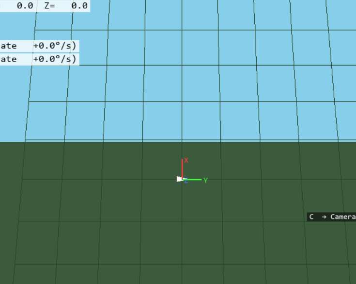
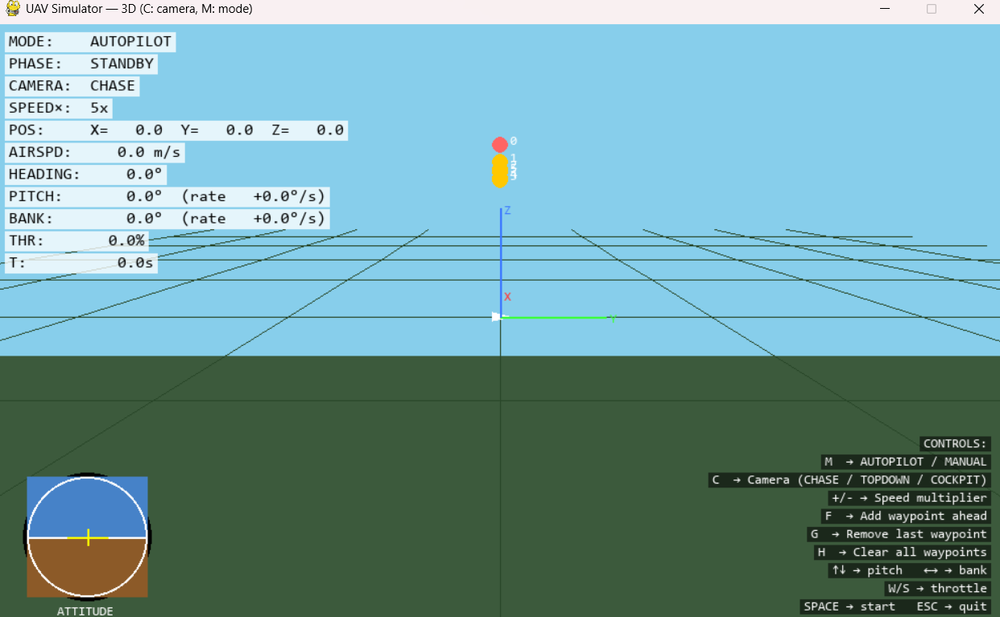

# 🛩️ Autonomous Fixed-Wing UAV Flight Simulator

A Python-based 2D/3D flight simulator for a fixed-wing UAV featuring realistic aerodynamics, PID autopilot, waypoint navigation, and full manual override — all without a physical transmitter.


## ✨ Features

- 🧮 **Realistic Physics** — Point-mass 3-DOF model with lift, drag, thrust, and gravity
- 🧠 **PID Autopilot** — Cascaded controllers for altitude, pitch, heading, bank, and speed
- 🗺️ **Waypoint Navigation** — Sequential tracking with acceptance radius
- 🛫 **Auto Takeoff & Landing** — Full state machine (STANDBY → TAKEOFF → CRUISE → LANDING → GROUND)
- 🎮 **Manual Control** — Keyboard override (pitch, bank, throttle)
- 🎥 **3 Camera Modes** — Chase, Top-down, Cockpit
- ⚡ **Speed Multiplier** — Run simulation at 1× → 50×
- 📍 **Dynamic Waypoint Editor** — Add/remove waypoints at runtime
- 📊 **Attitude Indicator** — Artificial horizon with pitch/bank rates
- 📈 **Flight Telemetry** — Auto-saved post-flight PNG plots


## 🎮 Controls

| Key | Action |
|-----|--------|
| `SPACE` | Start mission |
| `M` | Toggle AUTOPILOT / MANUAL mode |
| `C` | Cycle camera: CHASE → TOPDOWN → COCKPIT |
| `+` / `-` | Increase / decrease simulation speed |
| `F` | Add waypoint 300 m ahead |
| `G` | Remove last waypoint |
| `H` | Clear all waypoints |
| `↑` / `↓` | Pitch up / down (MANUAL) |
| `←` / `→` | Bank left / right (MANUAL) |
| `W` / `S` | Throttle up / down (MANUAL) |
| `ESC` | Quit |


## 🚀 Getting Started

### Prerequisites

- Python 3.10 or newer
- pip

### Installation

```bash
git clone https://github.com/myworkbench-0001/uav-simulator.git

cd uav-simulator
pip install -r requirements.txt


Project Structure

uav_simulator/
├── main.py                    # Entry point — game loop + state machine
├── config.py                  # Aircraft params, PID gains, mission config
├── requirements.txt
├── README.md
├── core/
│   ├── physics.py             # 3-DOF point-mass dynamics
│   ├── autopilot.py           # PID controllers
│   ├── navigation.py          # Waypoint tracking
│   ├── state_machine.py       # Flight phase transitions
│   ├── manual_control.py      # Keyboard → control commands
│   └── waypoint_editor.py     # Runtime waypoint editing
└── viz/
    ├── renderer.py            # 3D perspective view + HUD + gizmos
    └── telemetry.py           # Matplotlib post-flight plots


>

@Senal_shyaminda